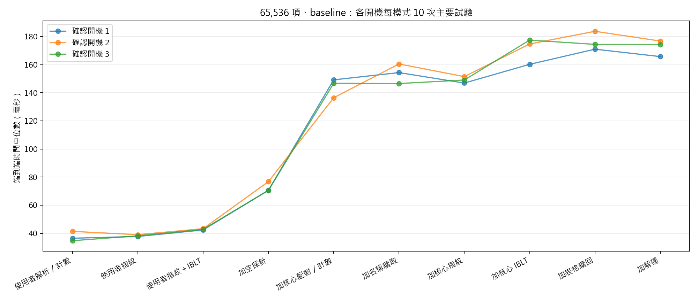

# 第一階段結果：量測完整性、觀測干擾與成本

日期：2026-10-23（Asia/Taipei）。本報告只涵蓋已核准的第一階段，未進入第二階段，論文及簡報未修改。

## 完成情形

一個先導開機後，完成三個不同 boot ID 的確認收集。原鎖定分析重現 1,296 批，7 項原測試通過；新增實作的 34 項先導測試通過。確認包含 1,800 次實收輸出核對、720 次完整判讀／還原核對、2,160 次成本試驗（其中 1,800 次主要分析、其餘為預先指定暖機）。

| 開機 | boot ID | 三組試驗耗時 | 環境及計時器 |
|---|---|---:|---|
| 1 | `2effd6ec-ee5c-4e85-846c-4868a11f1915` | 170.1 秒 | 核心／套件未變，計時器已恢復 |
| 2 | `ab3ab0c2-529f-4d13-9560-94caa311fd34` | 168.5 秒 | 核心／套件未變，計時器已恢復 |
| 3 | `2329b821-58b3-41a9-8b0a-9edc8ea83684` | 168.1 秒 | 核心／套件未變，計時器已恢復 |

耗時不含重新開機、資料匯出、程式實作與人工核對。每 boot 的成本表與成對增量見 [costs.csv](analysis/costs.csv)、[paired_increments.csv](analysis/paired_increments.csv)。

## 漏失統計：可用，但保證範圍有限

BCC 0.18.0 設定正數 maxactive 的返回探針實際透過 tracefs 建立，可讀到精確事件的 profile；本輪沒有更換掛接方式。原入口探針經 perf PMU，沒有出現在同一份 profile，不能宣稱所有入口／eBPF 執行漏失都已排除。核心 profile 的 missed 是返回探針內部 kprobe 與返回實例漏失的總和，亦不是某個 PID 的個別計數。

確認中，maxactive=1 的 90 個窗口誘發實際 missed，1,680 次相關列舉全部保守判為無效，false-valid 為 0。maxactive=256 的併發窗口結果逐 boot 見 [summary.json](analysis/summary.json)；90 個循序對照皆有效一致並完整解碼。缺少統計、解析錯誤、計數重設或事件身分不符不能預設為零。

**新增證據的實際意義：**原始資料中的 original_valid 是新增全域漏失門檻前的診斷版旗標，含一項新增的計數收支檢查。此旗標已拒判 1,680 次，但不能直接當成未修改舊版的結果。另用未修改的原判定函式做獨立回放：maxactive=1 的 3 個漏失窗口、56 次列舉全被原版拒判（40 次缺少必要紀錄而停止、16 次回報無效）；maxactive=256 的 56 次對照全有效。本輪沒有展示舊版誤判被修復，增加的是可直接觀察的漏失來源與保守拒判依據。舊正式資料未記錄的 missed 也無法事後補成零。回放不混入確認分母，見 [原版判讀對照](evidence/original_gate_reference_attempt1/manifest.json)。

來源：[BCC v0.18.0 的附掛實作](https://github.com/iovisor/bcc/blob/v0.18.0/src/cc/libbpf.c)、[Linux 6.8 的 profile 定義](https://github.com/torvalds/linux/blob/v6.8/kernel/trace/trace_kprobe.c)、[Kprobes 文件](https://www.kernel.org/doc/html/v6.8/trace/kprobes.html)。

## 掛接先後與觀測干擾

六種既有狀態，涵蓋兩種隱藏位置及等量改名；比較無探針、空探針、完整量測，後兩種再分探針先掛與模組先載入。buffer 為 256／65,536 bytes。1,800 次實收名稱位元組、inode、型態均符合預期；完整量測 720 次的指紋判讀與差異還原均正確。沒有觀察到這些組合中探針改變實收輸出的現象。

這補充先前未測的反向載入順序，不代表所有 rootkit、掛接技術或核心版本都不受觀測干擾。已知清單只作受控實驗 oracle，沒有加入第三視圖偵測架構。

## 成本：主要時間在逐項核心路徑，解碼不是最大部分

以下為 65,536 項、baseline；各數字先取每 boot 10 次主要試驗的中位數，再列三個 boot 的中位數範圍。暖機和無效資料的分母分開，沒有把負增量截為零。

| 模式 | 三個開機的中位數（ms） | 範圍（ms） |
|---|---|---:|
| 使用者解析／計數 | 36.46、41.35、34.71 | 34.71–41.35 |
| 使用者指紋 | 37.73、39.00、38.23 | 37.73–39.00 |
| 使用者指紋＋IBLT | 42.36、43.27、42.78 | 42.36–43.27 |
| 加空探針 | 70.58、76.73、70.50 | 70.50–76.73 |
| 加核心配對／計數 | 149.22、136.47、146.74 | 136.47–149.22 |
| 加名稱讀取 | 154.36、160.52、146.58 | 146.58–160.52 |
| 加核心指紋 | 146.92、151.50、149.08 | 146.92–151.50 |
| 加核心 IBLT | 160.25、174.72、177.49 | 160.25–177.49 |
| 加表格讀回 | 171.03、183.77、174.45 | 171.03–183.77 |
| 加解碼 | 165.76、176.83、174.41 | 165.76–176.83 |

在完整模式，表格／品質資料讀回約 2.72–2.90 ms，解碼 2.04–2.10 ms，清理 2.98–3.91 ms；整體為 165.76–176.83 ms。包含前後 profile／身分查詢的總時間為 166.61–177.62 ms。主要成本不是只在 Python 解碼。

空探針、逐項配對／狀態維護、名稱讀取、指紋及 IBLT 各有條件增量；IBLT 有可量測代價，但不宜把它當唯一瓶頸。原清理流程本身會掃描表格，故『省略明確讀回』也不等於完全沒有表格搬移。變體間有快取、排程、頻率與記憶體交互影響，模式差不硬換成加總必為 100% 的精確占比。每組隨機配對及其變異保留在 CSV。

成本主要分析共 1,800 次，無效／品質排除 0 次。這是新增診斷分支及控制器的成本，不覆寫舊實作 4.76 倍數值；若要主張新舊實作速度優劣，仍須同規約橋接。固定摘要 bytes 亦不等於全部實際配置記憶體，本輪沒有測得完整核心配置記憶體。

## 保留環境與可追溯性

已驗證新 Hyper-V 檢查點；原 main 保持乾淨，原 1,146 個追蹤檔案在原 checkout 及工作副本的 SHA-256 均未變。三次確認逐次檢查來源、核心與套件，更新計時器均已恢復。詳細資料見 [完整性核對](analysis/original_integrity.json)、[確認來源鎖](CONFIRMATION_LOCK.json)、[初始鎖](LOCK.json)。

原實驗 VM 本輪沒有執行 apt update、upgrade 或安裝新套件。這不是永久禁止升級；update 更新套件資訊，upgrade 改變已安裝套件。升級後可以作另一個環境比較，只是不能把同時改了環境的時間差全歸因於程式改良。[APT 官方手冊](https://manpages.debian.org/bookworm/apt/apt.8.en.html)

## 限制與下一個決策

只有原 VM、核心 6.8、ext4、靜態目錄及既有受控模組。三個開機不是三個獨立硬體或核心環境，零錯誤觀察不等於普遍保證。宿主 CPU／記憶體採樣約秒級，不能分解每次毫秒級呼叫的所有干擾。BCC 及舊模組的編譯／deprecation／BTF 警告留在原始紀錄；未升級工具消除它們。本輪由主代理核對實作與證據，額外代理因使用額度未完成獨立審查，未將其列為已通過的審查。

下一階段若繼續，優先考慮減少逐項核心探針與狀態更新的成本，再評估 IBLT 建表；單純延後解碼可省的時間有限。正式跨環境、獨立隱藏實作及動態目錄仍屬第二階段。第 4、5 項、一般程序監控與 /proc 延伸均未開始。本輪到此停止，不自動進入第二階段。

## 補充故障對照

五項故障對照獨立保存，沒有混入確認樣本。非法容量設定、兩端種子不符、刪除核心統計、注入未配對 depth 都判為無效。後兩項屬受控狀態注入，沒有冒充真正的排程漏失。

兩端合法設成 8 個儲存格、既有隱藏模組造成 16 個差異的本次對照：量測有效，IBLT 還原失敗，判讀為差異警報。此案例確認合法容量不足沒有抹掉指紋警報，並非一般解碼容量保證。

詳細結果見 [故障對照資料](evidence/fault_checks_attempt1/manifest.json)、[故障對照規約](FAULT_CHECK_PROTOCOL_zh-TW.md)。

## 資料量與核心資料表配置

另作未附掛探針的靜態稽核：單一診斷 BPF 物件的九張 map，fdinfo 的 memlock 欄位合計 7,866,112 bytes（7.50 MiB）；其中 IBLT map 為 7,341,536 bytes，max_entries=65536。這是全域資料表的核心回報值，不是每次列舉配置一份，也不是整個工具常駐／峰值記憶體的完整量測。

每次設定 256 個儲存格的邏輯摘要資料約 12.02 KiB，和全域 map 預留配置是不同指標，不能混稱實體記憶體。現有資料量比較不因此改寫成實體記憶體比較。後續若改良記憶體，可以研究全域 map 容量與宣告併發上限如何對齊；本輪沒有更改容量。見 [原始 fdinfo](evidence/map_memory_audit.json)。
