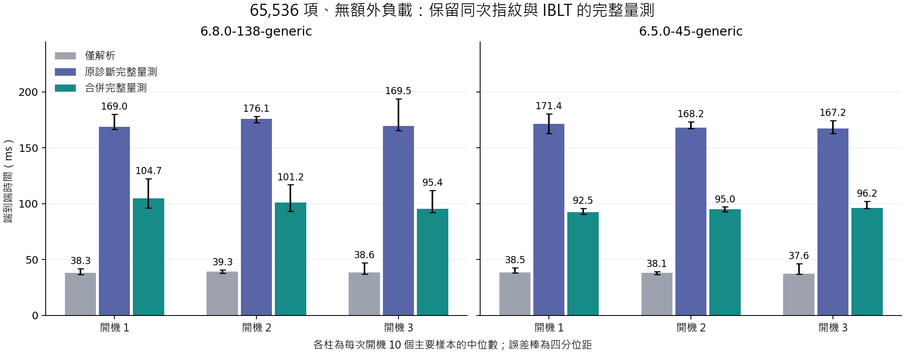

# 第二階段結果：適用證據與保留定位功能的成本改良

本輪沿用 filldir64 與專用 C 掃描器的 getdents64 兩端，補差異動作、檔案系統、動態目錄與另一作者實作，並驗證合併核心儲存的候選。沒有進入一般程序監控、/proc 或暫緩的第 4、5 項。

## 哪些問題已經有答案

| 問題 | 本輪能支持的結論 |
|---|---|
| 只變名稱以外欄位或新增項目是否有效？ | 已實測新增、變長／變短改名、inode-only、type-only、移除；有效且實際變更時須依身分差異判不同，重排作一致對照。 |
| 正常目錄在列舉時變動會不會自然誤報？ | 本輪正常動態試驗在同次兩端比對下維持一致；不是不同時間快照相等的保證。 |
| 是否只有單一核心／ext4 才有效？ | 增加 6.5 核心及 tmpfs 的受控證據，仍不是所有核心／FS 的保證。 |
| 核心逐項處理能否降低成本？ | 保留指紋、同次 IBLT 與拒判規則，改為每程序合併狀態及 cell 儲存，以配對時間判斷收益。 |

## 環境與確認分母

同一 Hyper-V 主機，原 VM 為 Ubuntu 22.04.5／Linux 6.8.0-138-generic，複本為相同使用者空間加指定 Linux 6.5.0-45-generic 套件，均 4 vCPU／8 GiB。兩台交替執行，不同時使用同 IP。6.5 是較舊核心的相容性對照；複本的磁碟布局不同，不能把跨環境的時間差全歸因核心。每環境三個新開機，各自先導不混入。

| 環境／開機 | boot ID | 量測靜態 | 無探針控制 | 動態 | 成本主要／暖機 |
|---|---|---:|---:|---:|---:|
| kernel68 / 1 | `902563c9-a02c-4a13-8e24-04ba304acd6e` | 960 | 44 | 80 | 180 / 36 |
| kernel68 / 2 | `e64f998e-7aa5-482a-8b51-748ae4f04012` | 960 | 44 | 80 | 180 / 36 |
| kernel68 / 3 | `a3ebeaca-0573-41f9-9894-d9a31c5db564` | 960 | 44 | 80 | 180 / 36 |
| kernel65 / 1 | `56a5ac85-3c07-48a5-8728-dccb9cff14ef` | 960 | 44 | 80 | 180 / 36 |
| kernel65 / 2 | `5b55d995-2142-4ffd-9a18-d783d3e4fa28` | 960 | 44 | 80 | 180 / 36 |
| kernel65 / 3 | `264cd6db-9ebb-4910-a3e1-8a6d630ec7fc` | 960 | 44 | 80 | 180 / 36 |

合計量測靜態 5,760 次（有效不同 4,560、有效一致 1,200、無效 0），另有無探針控制 264 次；正常動態 480 次。原始輸出逐筆重新核對，輸出不符、有效判讀錯誤、錯誤解碼成功皆為 0。

## 差異動作、還原與未實際變更

每個核心／FS／緩衝區／量測版按同規約執行。共 252 次靜態試驗因小緩衝區餘量不足，注入器沒有實際新增項目（含無探針控制）；本輪此類未變更全部發生在新增項目情境，變長改名的確認試驗均有實際變更。這些未變更對照沒有算成成功陽性。每種差異在大緩衝區均有實際變更的正例。完整分組與 skip 清單見 [summary.json](analysis/summary.json)。

差異還原以獨立預期名稱位元組、inode、型態計算 token 多重集合核對，不以解碼輸出當答案。正常重排只變順序，依原設計不應警報。差異警報不判斷是否惡意。合法小容量的獨立故障檢查另保存，還原失敗時仍保留有效指紋差異；這不保證任意差異量都可解碼。

## 動態目錄的結果如何解讀

480 次測試均要求掃描起訖內實際有建立、改名與刪除；無效 0、不同 0、未證實活動 0。掃描器在每次系統呼叫後固定等待 1 ms，增加背景操作交錯機會，屬排程壓力對照。此等待版不進成本比較。這支持受測的同次交付一致性，不能由此得到目錄的原子快照或動態隱藏攻擊偵測率。

## 另一作者實作與觀測干擾

採 xcellerator/linux_kernel_hacking 固定提交的目錄過濾函式，驗證無探針仍能隱藏，並比較模組先載／探針先掛。相容 ftrace helper 與原研究共用，因而是另一作者過濾實作的外部證據，並非獨立掛接家族、未知 rootkit 的偵測率或完整現實攻擊覆蓋。[來源與移植說明](third_party/xcellerator/PORTING_zh-TW.md)

## 改了什麼，以及有沒有省到主要成本

核心仍逐項建立指紋與 IBLT，也維持最外層返回 true 才計入。原診斷版將 depth、pending、指紋、統計與 IBLT 分置多張 map；候選先為每個登記執行緒配置一筆合併狀態，將 256 個 cell 一併存入，減少逐項查表及使用者端逐表讀回、清理。這不是正常時免建 IBLT，也沒有把第一次資訊丟掉後靠重掃定位。

兩版用同一 C binary、相同參數與隨機配對區組；總時間含程序啟動、登記、列舉、讀回、解碼、清理，另報含品質查詢的時間。編譯／附掛不在此邊界內。每格為該開機 10 次主要試驗的中位數；配對比值先逐區組計算，不是拿兩個獨立中位數硬除。

| 核心／開機，65,536 項、無額外負載 | 解析基線 ms | 原診斷完整 ms | 合併完整 ms | 配對比值中位數 |
|---|---:|---:|---:|---:|
| 6.8.0-138-generic / 1 | 38.26 | 168.95 | 104.65 | 0.604 |
| 6.8.0-138-generic / 2 | 39.28 | 176.09 | 101.24 | 0.577 |
| 6.8.0-138-generic / 3 | 38.65 | 169.48 | 95.43 | 0.549 |
| 6.5.0-45-generic / 1 | 38.53 | 171.36 | 92.52 | 0.556 |
| 6.5.0-45-generic / 2 | 38.05 | 168.22 | 94.96 | 0.555 |
| 6.5.0-45-generic / 3 | 37.57 | 167.23 | 96.22 | 0.574 |

預先指定門檻為每個開機的配對中位數比值 < 0.9 且品質沒有回退；本輪全部符合，可在受測範圍建議採用合併候選。較小目錄、CPU 負載及 IQR／範圍均保留在 [costs.csv](analysis/costs.csv)、[paired_costs.csv](analysis/paired_costs.csv)，不只挑最大目錄的有利數字。

這是同規約的新舊診斷版比較，沒有重新定義或覆寫原論文 4.76 倍。改善來自儲存與控制流程，非新增安全保證，也不能只歸因於雜湊／IBLT 演算法本身。

## 資料量與配置指標

| 環境／開機 | 原診斷 map memlock MiB | 合併 map memlock MiB |
|---|---:|---:|
| kernel68 / 1 | 7.502 | 2.598 |
| kernel68 / 2 | 7.502 | 2.598 |
| kernel68 / 3 | 7.502 | 2.598 |
| kernel65 / 1 | 7.501 | 2.597 |
| kernel65 / 2 | 7.501 | 2.597 |
| kernel65 / 3 | 7.501 | 2.597 |

每次 256 cells 的邏輯摘要大小不變。表中是未附掛時 fdinfo 的核心 memlock 指標，不是整工具實體常駐／峰值。候選每筆預留最多 256 cells、表最多 256 執行緒；原版全域 65,536 cell 容量在每筆 256 時也是理想 256 筆，不能只看 monitored_pids 的 1024 上限就說原版完整定位可同時容納 1024 筆。候選對很小 cells 仍預留整筆，記憶體取捨要按宣告容量解讀。

## 保存、限制與下一個決策

原 main 保持乾淨，原版 1146 檔、包含第一階段的基準 1305 檔逐檔 SHA-256 不變。各確認結束檢查版本與計時器，資料、失敗、無效與先導分開封存。來源鎖按兩環境分開，完整核對見 [base_integrity.json](analysis/base_integrity.json)。

兩個核心各通過 10 個原生測試方法，各保留 18 份子案例證據；另由主機重新核對來源、判讀與故障控制。包含真實返回漏失、缺少狀態、未配對、配置與種子不符、16 程序併發及小容量失敗。原 VM 的核心、套件、更新計時器及清理狀態亦核對通過。[原生故障與結束環境核對](analysis/native_and_environment_verification.json)

已請求額外代理審查，但因工作區額度不足沒有產生獨立審查結果；由主代理自查並以實測核對，不將其列成已通過的獨立審查。

限制仍包含同一實體主機、兩個指定核心、ext4／tmpfs、受控差異與特定第三方範例。零錯誤觀察不是對所有輸入的保證。返回 profile 不涵蓋入口 perf 探針的全部執行漏失；同核心量測與公開種子的信任限制也沒有被這次優化解除。

本輪到第二階段結束。若後續核定第三階段，才建立「只讓專用掃描器看到完整資料」的案例並評估觀察其他程序自己的列舉；這與本輪成本改良是不同研究問題。論文、簡報、GitHub 主分支尚未由本輪更新。

方法與文獻依據見 [執行前規約](PROTOCOL_zh-TW.md)、[先導核對](PILOT_REVIEW_zh-TW.md)。
